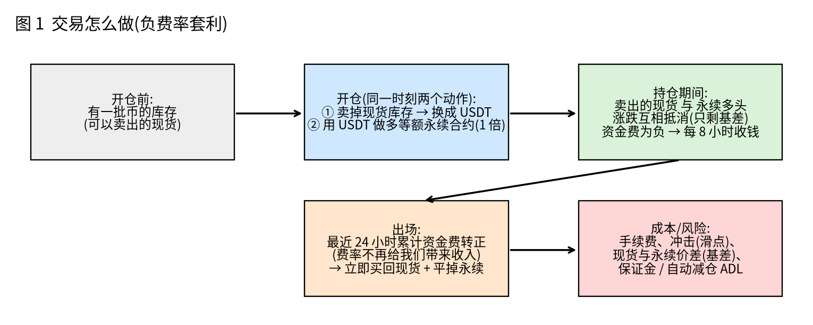
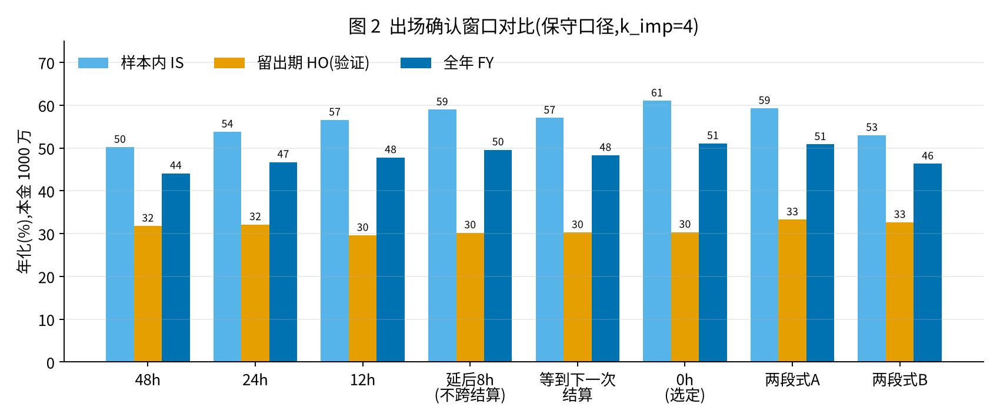
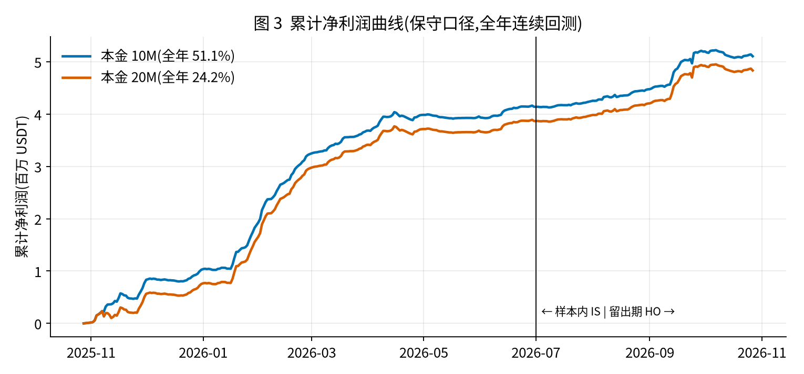
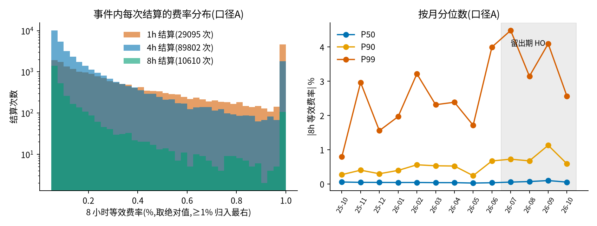
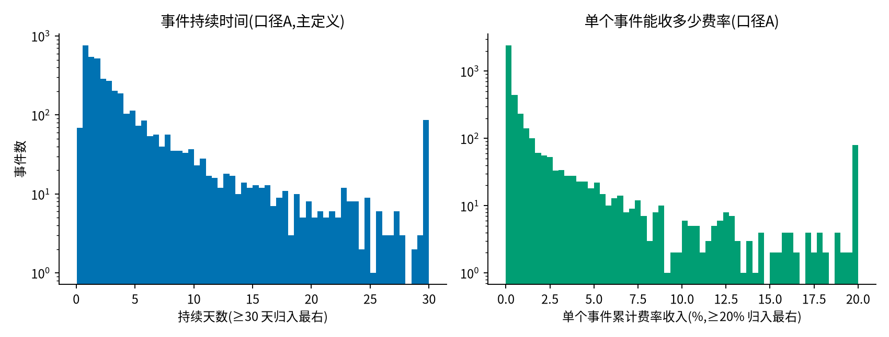
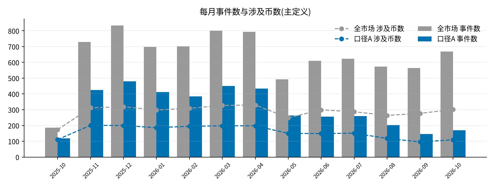
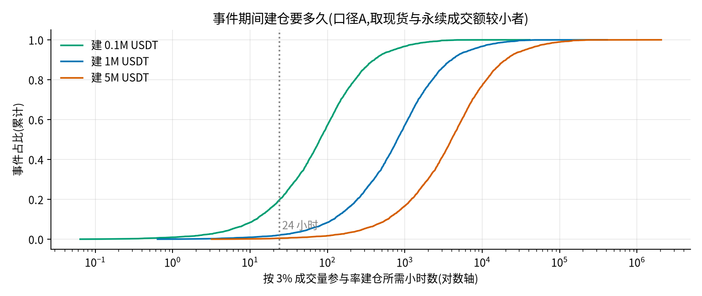
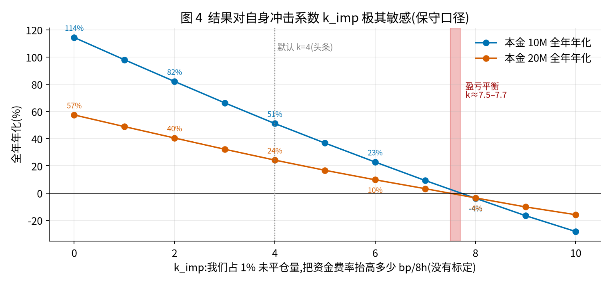

# 负费率策略:团队汇报

> 范围说明:本文只给汇总数字,不含任何库存数量、持仓明细或私有清单。所有数字都是**历史回测模拟**,不是实盘业绩。数据截至 2026-10-27(UTC)。读者不需要任何背景知识,名词见文末名词表。

## 0. 一页纸摘要

- **策略在做什么**:当某个币的永续合约“资金费率”为负时,做多永续的一方每 8 小时(个别币 4 小时/1 小时)能**收到**钱。我们卖出库存里的现货,同时做多等额的永续合约,让价格涨跌互相抵消,只赚这笔资金费(以及现货与永续之间价差的变化),直到费率不再为负。
- **保守口径下的历史模拟结果(本金 1000 万 USDT)**:全年(2025-10-28 → 2026-10-27,365 天)年化 **51.1%**,约 **511 万 USDT** 净利润;样本内 61.0%,留出期 30.3%;95% 区间 **33%–71%**(只反映时间段的运气波动,不含模型本身可能不对的风险)。本金 2000 万时全年年化 24.2%、净利润约 484 万。请把它理解为“保守的模拟结果”,**不是对实盘的承诺**。
- **利润有容量上限**:一年净利大约 **480–510 万 USDT**(保守口径,1000 万或 2000 万本金都是这个量级)。**加本金不会多赚,可能略少**(2000 万比 1000 万少约 27 万,配对 95% 区间 [−78, +0] 万),要扩大规模得先解决容量(库存、成交量、自身冲击)。
- **最大的不确定性是一个没有标定的参数 `k_imp`**(我们占某币 1% 未平仓量时,会把该币资金费率抬高多少)。默认取 4:年化 51.1%;取 2:82%;取 6:约 23%;**取到约 7.7 才刚好不赚不亏**。只有实盘小额试验才能量出来。
- **利润高度集中**:全年前 5 个币(**事后**按贡献排名,事前选不出来)贡献约 46% 净利润;留出期前 5 个币约 95%,其中 9 月一个月约占留出期净利的 73%,10 月为负;去掉前 5 个币,留出期年化只剩约 1.6%。这是一个**事件驱动**的策略,不是“每月稳定赚”。
- **511 万依赖几个简化假设**:借来的币不归还、无利息,等同自有库存;卖出时不涉及保证金借贷;单腿成交失败(只成交一条腿)的裸露敞口没有建模;交易所 ADL(自动减仓)只有代理指标(见 §6)。保证金与强平风险很低:卖出的是自有库存(含借来不归还的币),永续是 1 倍全额保证金(见 §6.5)。
- **出场规则**:“最近 24 小时累计资金费率转正”这个条件一成立就出场(0h,不等待)。它是按一条**事先定好、只看 2026-06-30 之前数据**的规则选出来的,比“等到下一次结算再出场”全年高约 1.5–3 个百分点(取决于成本口径),7–10 月两者基本相同;冲击小时(k_imp≤2)分不出高下,k_imp=0 时等一等略好。0h 的优势**完全来自模型对我们自身冲击成本的假设**,单看市场,等一等反而略有小正收益(见 §3.2)。最终用小额实盘并行来定。
- **KuCoin 现货版本(对照)**:把卖现货这条腿放到 KuCoin、永续仍在币安,同口径全年年化 **7.4% [2.7, 12.8]**,比主版本低约 44 个百分点;主因是 KuCoin 现货成交量小、能做的规模小;结论是不可行(见 §5A)。
- **需要团队做的事**:批准一次**小额实盘试验**(几十万到约 100 万 USDT,1–2 个月),量自身冲击 k_imp、两条腿的成交时间差、真实成本,并让 0h 与“等到下一次结算再出场”并行,用真实成交决定(见 §7)。

## 1. 背景:永续合约和资金费率

**永续合约**是一种没有到期日的期货。它的价格(永续价)需要贴着现货价走,交易所用一个机制把它“拉回去”,这个机制就是**资金费率**(funding rate):

- 每隔一段时间(多数币每 8 小时一次,部分币缩短到 4 小时或 1 小时)结算一次;
- **多头和空头之间互相转账**,交易所不赚这笔钱;
- 费率**为正**(最常见):永续价偏贵,**多头付钱给空头**;
- 费率**为负**:永续价偏便宜或空头太拥挤,**空头付钱给多头**,也就是**做多永续的人反而能收钱**。

例:某币费率为 −0.10% / 8 小时,我们持有名义额 100 万 USDT 的永续多头,则每 8 小时收到 1000 USDT(100 万 × 0.10%)。

几个后面会用到的单位:**bp**(基点)= 0.01%,所以 30bp = 0.30%;**名义额** = 合约面值乘以价格,也就是持仓“有多大”;**基差** = 永续价 − 现货价,永续折价时基差为负。

## 2. 策略:赚的是什么

我们并不预测币价涨跌。做法是把两条腿放在一起:

1. **卖出现货**(来自我们的库存);
2. **做多等额永续合约**(1 倍,不加杠杆)。

现货卖出和永续多头方向相反,币价涨跌时两条腿的盈亏基本互相抵消。剩下的利润来源只有:

- **资金费**:费率为负时,我们是多头,每次结算**收钱**(主要收入);
- **基差变化**:永续折价越大,将来收敛(永续追上现货)时我们越赚;
- 减去成本:**手续费**、**冲击成本**(我们自己下单把价格推坏,也叫滑点)。

**利润口径(要特别说明)**:回测只统计“这对仓位”产生的盈亏 = 现货腿价格盈亏 + 永续腿价格盈亏 + 资金费 − 手续费/冲击。库存本身的涨跌**不计入**(无论做不做这笔交易,库存都会涨跌)。

**钱从哪来,一个直观的账**(本金 1000 万,全年,保守口径):

| 项目 | 金额(万 USDT) | 含义 |
|---|---|---|
| 资金费收入(已扣自身冲击对费率的抬高) | +639 | 做多永续在负费率期间收到的钱 |
| 基差收益 | +229 | 永续折价收敛带来的价差收益 |
| 手续费 | −44 | 现货 10bp、永续 5bp(吃单价) |
| 冲击成本 | −313 | 下单把价格推坏的成本 |
| **净利润** | **约 +511** | 全年约 1776 次开平仓循环,平均每次持仓约 215 小时(约 9 天;定义:每个币从开仓到平完算一次,“持仓币·小时总数 ÷ 开平仓次数”,含逐步建仓/减仓期间),平均占用资金约 449 万 |

## 3. 规则

所有结果都用同一套规则。

### 3.1 入场与风险控制

**入场(什么时候开仓)**:

- 该币资金费率明显为负,并且通过**成本门槛 m=2**:预计能拿到的收入(资金费 + 基差收敛)至少是预计交易成本的 **2 倍**才开仓;
- 过滤掉“可能被交易所自动减仓”的危险时点(见下表 ADL)。

**风险控制**(都是硬限制,不是事后扣):

| 控制项 | 含义 |
|---|---|
| **pov 3%**(参与率) | 每小时我们的成交额不超过市场成交额的 3%,避免一次把价格砸坏 |
| **成交量上限 10%** | 单币持仓不超过该币 24 小时成交额的 10% |
| **OI 上限 10%** | 单币持仓不超过该币未平仓量(OI)的 10% |
| **库存上限(币数量 + 美元双上限)** | 卖出的现货不能超过库存币数量,也不能超过美元限额 |
| **ADL 过滤** | ADL(自动减仓)是交易所在极端行情下强制平掉盈利仓位的机制。我们用代理指标:币价 1 小时涨超 10% 且币本位 OI 下降后 24 小时内**不新开仓** |
| **1 倍永续、不加杠杆** | 全额保证金,只有价格接近 0 才会被强平;剩下的风险是 ADL 和单腿成交(见 §6.5、§6.6) |
| **资金占用上限** | 仓位占用不超过本金 |

### 3.2 出场规则:24 小时累计费率转正就出场(0h)

**规则**:当“最近 24 小时累计收到的资金费转为正”(也就是这个币过去一天不再给我们带来净收入)这个条件**一成立就平仓**(买回现货、平掉永续),不再等待。注意这里说的是“24 小时累计”转正,不是“当前一次费率”转正:约 12.3% 的触发发生时,当前费率其实仍为负(只是更早、更负的一次结算滑出了 24 小时窗口)。

**怎么选的**:事先定好规则——**样本内(2026-06-30 之前)年化最高者胜,差 2 个百分点(pp)以内取更简单者**;留出期只作验证。默认 k_imp=4、本金 1000 万下,样本内最高的是 0h(61.0%);两段式 A(59.3%)与 0h 差 1.8pp,在 2pp 以内,取更简单的 0h。

| 出场方式(本金 1000 万,保守口径,k_imp=4) | 样本内 IS | 留出期 HO | 全年 FY [95% 区间] | FY 对 0h 的配对差 [95% 区间] |
|---|---|---|---|---|
| **0h(选定:条件一成立就平)** | **61.0%** | 30.3% | **51.1% [33, 71]** | — |
| 等到下一次结算再出场(按各币自己的结算间隔等,中位数 4 小时、均值 5.7 小时) | 57.0% | 30.3% | 48.3% [31, 68] | −2.8pp [−4.4, −1.3] |
| 延后 8 小时出场(不跨结算) | 59.0% | 30.2% | 49.6% [32, 69] | −1.5pp [−2.5, −0.7] |
| 延后 12 小时出场 | 56.6% | 29.6% | 47.8% [30, 67] | −3.3pp [−5.3, −1.4] |
| 延后 24 小时出场 | 53.8% | 32.1% | 46.7% [30, 66] | −4.4pp [−7.5, −1.0] |
| 延后 48 小时出场 | 50.2% | 31.8% | 44.1% [27, 63] | −7.0pp [−10.9, −3.1] |
| 两段式 A:条件一成立先平 50%,持续 24h 再平其余 | 59.3% | 33.3% | 50.8% [33, 71] | −0.2pp [−2.0, +2.1] |
| 两段式 B:条件持续 24h 先平 50%,持续 48h 再平其余 | 53.0% | 32.7% | 46.3% [29, 65] | −4.8pp [−8.2, −1.2] |

**名词**:“延后 N 小时”= 条件要连续成立 N 小时才平仓。“延后 8 小时”对每 8 小时结算一次的币,会在第 7 小时就出场,**并没有等过一次新的结算**;真正“等一个周期”的是“等到下一次结算再出场”这一行。“延后 8 小时”比 0h 样本内低 2.1pp,刚好在 2pp 容差的边缘。

**怎么读**:

- **结论随 k_imp 而变**:k_imp≥2 时规则选 0h;**k_imp=0 时规则选的是 24h**,0h 在样本内反而排在末位。也就是说,自身冲击越小,越应该多等一等。
- **0h 比“等到下一次结算”好多少**:全年高约 1.5–3pp,取决于成本口径——保守口径(对“出场条件已成立、还在等待中”的小时也扣自身冲击)为 +2.8pp;不扣这部分时约 +1.7pp [+0.5, +3.1]。7–10 月两者基本相同(差 −0.1 到 +0.2pp);k_imp≤2 时分不出高下;k_imp=0 时等一等略好(约 +1pp)。
- **为什么 0h 领先**:**完全来自模型对自身冲击成本的假设**(k_imp 的大小,以及等待期间我们的仓位继续推高费率的成本)。单看市场本身(不计我们的冲击,含基差变化),24 小时累计费率转正后再等 48 小时,平均还有约 **+2.2bp [+1.1, +3.4]** 的小正收益,所以不能说等待没有收益。0h 的优势在时间上也集中在 11 月到 4 月,5 月中旬以后基本为 0。
- **分段滚动检验**:把一年分成 6 段,每段只用之前的数据选方案、在下一段检验。结果只说明**规则选择稳定,不证明 0h 更好**;真正落在 6/30 之后的两段里,0h 只比“等到下一次结算”高 0.1–0.3pp,而两段式 A 在这两段里高于 0h。另外,改用单次结算转正触发时,各种等待方式都没有超过 24 小时累计口径的最佳结果。
- **代价**:0h 全年开平仓约 1776 次,手续费与冲击都更多,实盘跟单与监控压力更大。2000 万本金下结论方向相同。

**限制(请连同 0h 一起引用)**:

- **0 小时只在“24 小时累计费率转正”这个出场条件下成立;换成单次结算转正就出场,k_imp=2 时等一等更好。**
- **拥挤没有建模**:很多参与者同时出场造成的冲击不在模型里;0h 的出场与别人更同步,这一风险对它更大。

## 4. 回测是怎么做的

- **数据**:币安公开的小时 K 线、资金费率、未平仓量等;币种池 339 个(用的是今天的快照,有一定“事后诸葛”成分);
- **时间**:2025-10-28 → 2026-10-27,共 365 天,按小时模拟;
- **IS / HO / FY**:**IS(样本内)** = 2025-10-28 → 2026-06-30(246 天),出场规则只用这一段来选;**HO(留出期)** = 2026-07-01 → 10-27(119 天),只用来验证;**FY(全年)** = 把两段连在一起连续跑 365 天;
- **成本**:吃单手续费(现货 10bp、永续 5bp)+ 冲击成本 30bp + 半个点差;**自身冲击**(k_imp)另算:我们的仓位会把资金费率往对我们不利的方向推;
- **年化 = 净利润 ÷ 本金 ÷ 年数**。这是对“本金”的年化,不是对“实际占用资金”的年化(1000 万本金平均只占用约 449 万);
- **95% 区间**:把全年按 7 天一块随机重抽 5000 次(bootstrap),看年化的波动范围。**这个区间只反映“运气的波动”,不包含模型本身可能不对的风险**(比如 k_imp 猜错),所以实际不确定性比区间大得多。

## 5. 结果

**头条结果(保守口径)**

| 本金 | 样本内 IS 年化(净利润) | 留出期 HO 年化(净利润) | 全年 FY 年化(净利润) | 全年 95% 区间 |
|---|---|---|---|---|
| **1000 万** | 61.0%(411 万) | 30.3%(99 万) | **51.1%(511 万)** | **33%–71%** |
| 2000 万 | 28.5%(384 万) | 15.2%(99 万) | 24.2%(484 万) | 15%–34% |

怎么读图 3:曲线整体向上、没有大回撤(全年日度累计净利的最大回撤约 15 万 USDT),但利润集中在几段行情(全年净利润中 2 月约 26%、1 月约 18%、11 月约 15%、9 月约 14%),平静期基本是横盘。

**为什么本金翻倍,年化反而减半?这是两件事,都成立,不是主次关系:**

- **① 本金翻倍利润不增长 = 容量封顶。** 不考虑自身冲击(k=0)时,2000 万与 1000 万的净利润几乎一样(约 1147 万 vs 1143 万);受库存、成交量和 pov 限制,装不下更多资金,多出来的本金用不上。留出期两种本金的净利润甚至完全相同(都约 99 万)。
- **② 2000 万没有多赚、可能略少(484 万 vs 511 万,差 −27 万,95% 区间 [−78, +0] 万)。** 仓位越大,自身冲击越大(2000 万平均占用 467 万 vs 1000 万的 449 万;冲击成本 331 万 vs 313 万)。我们另有一个“按冲击大小调整仓位”的开关(默认关),打开后 2000 万从 24.2% 升到约 26.0%、1000 万从 51.1% 升到 53.4%,差距缩小但没有消失。

**容量的量级**:保守口径一年净利约 480–510 万;乐观口径(不对费率本来 ≥ 0 的小时计自身冲击)约 570–590 万;即使完全不计自身冲击(k=0)也只有约 1140 万。

## 5A. KuCoin 现货版本(对照)

**是什么**:策略逻辑与主版本完全相同(负费率时卖现货、做多等额永续,24 小时累计费率转正就出场),唯一区别是**卖现货这条腿放在 KuCoin 现货市场**,永续腿和资金费仍用币安。做法是**在 KuCoin 卖出的是自有库存(含借来不归还的币),同时在币安做多永续**收资金费,不借币。因为两条腿在两个交易所,能做多大取决于**两边中较小的那个成交量**,而 KuCoin 现货的成交量远小于币安。

**口径(与主版本相同)**:保守口径、自身冲击 k_imp=4、0h 出场、本金 1000 万 USDT、同样的 7 天循环块 bootstrap(5000 次);与主版本的差值是和主版本已有结果逐日配对计算的。

- **库存**:库存上限沿用币安口径(同样的库存和可借额度),**假设这些库存已经划转到 KuCoin**;卖出的是自有库存(含借来不归还的币);
- **币种**:主版本 339 个币里,KuCoin 有同名 USDT 现货对且数据通过检查的 **318 个**(以今天仍上市的交易对为准,有幸存者偏差);
- **时间**:与主版本相同,2025-10-28 → 2026-10-27,三个区间(全年、6/30 之前、7–10 月)都有数据,**没有缺失区间**;KuCoin 无成交的小时视为不可成交,不做任何填充。

**结果(本金 1000 万)**

| 区间 | KuCoin 版年化 [95% 区间] | 净利润 | 主版本年化 | 差(KuCoin − 主版本)[95% 区间] |
|---|---|---|---|---|
| **全年 FY** | **7.4% [2.7, 12.8]** | 约 73.5 万 | 51.1% [33, 71] | −43.7pp [−60.3, −28.5] |
| 样本内 IS(6/30 前) | 9.5% [2.6, 17.4] | 约 63.8 万 | 61.0% | −51.6pp [−71.8, −32.3] |
| 留出期 HO(7–10 月) | 3.4% [1.6, 5.4] | 约 10.9 万 | 30.3% | −27.0pp [−53.7, −5.9] |

**成本拆分(全年,318 币)**:资金费收入约 91.7 万,基差收益约 +21.0 万,手续费约 −5.1 万,冲击 + 点差约 −34.0 万,合计净利约 73.5 万。全年成交额约 3420 万,冲击 + 点差约占成交额的 1.0%。手续费按 KuCoin VIP0 吃单 0.10%。

**为什么低这么多:容量,不是成本**:

- **成交量对比**(2025-10-28 → 2026-10-27 全年成交额,318 个币):KuCoin 现货 / 币安现货,逐币全年合计之比的中位数约 **4.6%**,全体合计之比约 **12.6%**;KuCoin 现货 / 币安永续,逐币中位数约 1.0%,全体合计约 2.3%;
- 全年平均占用资金约 82 万 USDT(主版本约 449 万),持仓时间里约 36% 的币小时被成交量上限卡住;
- 所以按 1000 万本金摊薄后年化很低。按实际平均占用资金(约 82 万)算,全年年化约 89%(这里只算了现货腿的占用;币安合约保证金要另外出,实际占用约翻倍,按此折算约 45%),但这只是很小规模下的数字,**不能外推到 1000 万**;7–10 月平均只占用约 13.8 万,按占用资金算的数字没有意义。

**主要风险与局限**:

- **更集中**:全年前 5 个币(事后排名)贡献约 83% 净利润,去掉它们全年年化只剩约 1.3%;
- **冲击成本可能偏乐观**:冲击系数沿用币安永续的校准(KuCoin 现货没有公开历史逐笔数据),而薄盘口上的冲击是非线性放大的,真实冲击可能更大;
- **点差是静态快照**:取自 2026-11 的 20 次买一/卖一快照的逐币中位数(中位币半个点差约 0.13%),套用到全年;
- **两条腿在两个交易所,无法同时成交**:回测假设同一小时两边都成交,实际会有时间差和单腿成交风险;保证金不能互相抵用,行情剧烈时需要在 KuCoin 和币安之间划转资金,提币/转账的时间与费用没有建模;KuCoin 薄币有错误的价格毛刺;
- **实际资金占用约为名义额的 2 倍**:现货卖出款留在 KuCoin,不能直接当币安永续的保证金,币安那边的保证金要另备资金或跨交易所划转,所以 KuCoin 版的真实资金占用接近名义额的 2 倍(以上年化没有按这个重算),这让 7.4% 更没有吸引力。

**结论**:KuCoin 现货版**不可行**。同口径全年年化 7.4% [2.7, 12.8],比主版本低约 44 个百分点;实际资金占用接近名义额的 2 倍;而且冲击成本可能偏乐观,真实结果可能比 7.4% 更差。

## 5B. 负费率事件统计:负费率通常有多深、多久、多频繁

这一节不看策略赚多少,只看市场本身:负费率出现时,费率有多深、持续多久、多久来一次、成交量够不够。

**数据与范围**

- **时间**:与头条回测相同,2025-10-28 → 2026-10-27(含,UTC,共 8760 小时);**留出期 HO** = 2026-07-01 起。2025-10 只有 4 天。
- **数据**:币安 USDT 本位永续的历史资金费率(币安公开数据)。口径A 的成交量和未平仓量(OI)用的是头条回测的同一份数据集。
- **两个范围**:
  - **口径A(主范围)**:与头条回测相同的 339 个币,即我们有库存或可借额度、能做的币。这里只给汇总数字。
  - **全市场(对照)**:这一年里有资金费率记录的全部 USDT 永续,共 844 个,包括已经下架的币。

**什么算一个“事件”(入场/出场阈值与策略近似一致)**

- 所有费率都先换算成 **8 小时等效**:单次费率 × 8 ÷ 结算间隔小时数。比如 1 小时结算一次的币收 −0.01%,8 小时等效就是 −0.08%。
- **主定义**:某次结算的 8h 等效费率 **< −0.05%**(即入场门槛)时事件开始。之后逐小时检查,**过去 24 小时累计资金费转为正数**时事件结束(即出场规则)。
- **宽松定义(对照)**:只要费率 < 0 就算开始,结束规则相同。
- 事件期间收到的资金费都算作这个事件的“累计费率收入”(按每 1 USDT 永续多头名义计)。
- **这是市场侧的近似**:入场阈值(< −0.05%)和出场规则(24h 累计转正)与策略相同,但这里用的是市场滚动 24h 累计,不含策略开仓时的清零、自身冲击、m=2 成本门槛、ADL、库存和借币等条件。另外,触发事件的那一次结算在策略看到时已经结算完,实际拿不到;去掉这一次后,单事件收入中位数从 0.19% 降到约 **0.12%**,低于 0.30% 手续费的事件占比从 59% 升到约 64%。
- **事件会碎片化**:同一个币上一事件结束后不到 24 小时又重开的情况不少。把间隔 < 24 小时的事件合并后,口径A 事件数从 3,998 变为 **3,481**(约 −13%)。所以“事件”是策略视角的一进一出,不等于独立的负费率行情;绝对事件数随结束规则变化,但月度趋势不变。

**一张表看全貌(主定义)**

| 指标 | 口径A | 全市场 |
|---|---|---|
| 全年事件数 | 3,998 | 8,274 |
| 涉及币数 | 315 | 756 |
| 其中留出期 HO 的事件数 | 778 | 2,428 |
| 持续时间 中位数 [P25, P75] | 56 小时 [28, 116] | 44 小时 [24, 92] |
| 持续时间 P90 / P99 | 261 / 1,028 小时 | 200 / 878 小时 |
| 单个事件累计费率收入 中位数 | 0.19% | 0.15% |
| 单个事件累计费率收入 P90 / P99 | 3.7% / 35.1% | 2.6% / 29.2% |
| 事件内最深费率(每个事件取最深的一次)中位数 / P90 / P99 | 0.11% / 1.29% / 6.6% | 0.12% / 1.19% / 8.1% |
| 最深的一次(8h 等效) | −16%(1 小时结算、单次触及 −2% 的币) | −16% |
| 收入最多的单个事件 | 约 122% | 约 122% |

宽松定义下(费率 < 0 就算),口径A 全年有 53,181 个事件,中位数只持续 1 小时,累计收入中位数仅 0.004%。绝大多数“负费率”只是在零附近闪一下,没有交易价值。所以下面都用主定义。

### 5B.1 费率分布

图 E1 左:只画比 −0.05% 更深的结算,纵轴为对数刻度。右:按月份的分位数,灰色区域是留出期。

**事件期间每一次结算的 8h 等效费率**(口径A,共 129,507 次结算,按绝对值统计。事件尾段费率回升,也会出现正数):

| 分位(按深度) | P25 | P50 | P75 | P90 | P99 | 最深 |
|---|---|---|---|---|---|---|
| 8h 等效费率 | −0.01% | −0.04% | −0.14% | −0.49% | −2.7% | −16% |

即:事件内一半的结算比 −0.04% 浅(事件开始后费率常常很快回到零附近,但 24 小时累计还没转正),25% 比 −0.14% 深,10% 比 −0.49% 深,1% 比 −2.7% 深。约 17%(16.9%)的结算已经回到正费率(多数是 +0.01% 的基础利率)。

**按结算间隔分**(口径A,事件期间的结算):

| 结算间隔 | 占结算次数 | 占事件数(按事件主要间隔) | 8h 等效费率 P50 / P90 / P99 |
|---|---|---|---|
| 1 小时 | 22.5% | 2.8% | −0.20% / −1.44% / −5.1% |
| 4 小时 | 69.3% | 78.4% | −0.03% / −0.24% / −1.5% |
| 8 小时 | 8.2% | 18.9% | −0.03% / −0.13% / −0.96% |

- **1 小时结算的币要单独看**:事件数只占约 3%,但结算次数占 22%,而且费率最深。币安通常是在某个币费率极端时,把它改成 1 小时结算。
- **按月份看**(图 E1 右,口径A):P50 一直在 −0.03% 到 −0.10% 之间;P90 在 −0.24% 到 −1.13% 之间;P99 在 −0.8% 到 −4.5% 之间。**留出期 7–10 月的 P90 和 P99 并不比上半年浅**(9 月 P90 达到 −1.13%,是全年最深)。注意:这里的按月分位数**按结算次数加权**,1 小时结算的币每天结算 24 次,权重偏大;如果每个币等权,9 月 P90 只有约 −0.39%。按事件看(每个事件最深一次),留出期仍不比样本内浅。但 7–10 月的事件数明显减少,见 5B.3。

### 5B.2 持续时间与每个事件能收多少

- **持续时间**(口径A):中位数 56 小时(约 2.3 天),P75 约 5 天,P90 约 11 天,P99 约 43 天。到数据截止时还有 36 个事件没有结束。
- **边界截断说明**:统计区间为 2025-10-28 至 2026-10-27(含)。(1)区间结束时仍未结束的 36 个事件,持续时间按“截至区间终点”计入分位数(右截断),所以真实持续时间分位数会略长于这里的数字;(2)在 10-28 之前就已开始的事件,一律从区间起点算起(其中 30 个事件在区间第 1 个小时就处于负费率中),持续时间和收入都只算区间内的部分。2025-10 只有 4 天却有 118 个事件,主要就是这个原因,不代表 10 月负费率特别多。
- **一个事件能收多少费率**(口径A,按每 1 USDT 名义):中位数只有 **0.19%**,P75 为 0.84%,P90 为 3.7%,P99 为 35%。
- **怎么理解**:两条腿开仓加平仓,光吃单手续费就约 0.30%(现货 0.10% ×2 + 永续 0.05% ×2),还没算冲击成本。口径A 中约 **59% 的事件**整段累计费率收入低于这 0.30% 往返手续费(这是粗比较:收入不含基差收益,成本不含冲击)。所以**中位数事件本身不够覆盖成本**,赚钱主要靠少数又深又长的事件。这也是策略要设门槛、要做筛选的原因。

### 5B.3 频率与集中度

**每月事件数和涉及币数**(主定义):

| 月份 | 口径A 事件数 | 口径A 涉及币数 | 全市场事件数 | 全市场涉及币数 |
|---|---|---|---|---|
| 2025-10(仅 4 天) | 118 | 111 | 187 | 174 |
| 2025-11 | 424 | 201 | 729 | 312 |
| 2025-12 | 479 | 200 | 834 | 319 |
| 2026-01 | 412 | 186 | 698 | 298 |
| 2026-02 | 384 | 195 | 701 | 309 |
| 2026-03 | 450 | 198 | 800 | 327 |
| 2026-04 | 433 | 198 | 794 | 330 |
| 2026-05 | 264 | 150 | 493 | 249 |
| 2026-06 | 256 | 149 | 610 | 299 |
| 2026-07 (HO) | 260 | 151 | 623 | 287 |
| 2026-08 (HO) | 202 | 118 | 573 | 264 |
| 2026-09 (HO) | 146 | 96 | 564 | 277 |
| 2026-10 (HO) | 170 | 109 | 668 | 301 |

- **口径A 的事件在变少**:11 月到 4 月月均约 430 个(384–479),7–10 月月均约 194 个(146–260),下降约 55%;而且 5–6 月已经降到 264/256 个,早于留出期。**全市场同期也在下降**:11–4 月月均约 759 个,7–10 月约 607 个,下降约 20%。口径A 下降得更快,提示新的负费率更多出现在口径A 之外的币上,但原因未验证(口径A 是今天的币池快照,也可能有选择偏差)。这和留出期年化下降(30.3% vs 样本内 61.0%)方向一致,但只是相关,不是证明。
- **集中度**(按事件累计费率收入加总,每 1 USDT 名义,不考虑能做多大):

| 范围 | 前 5 个币占比 | 前 10 个币占比 | 收入最高的 10% 事件占比 |
|---|---|---|---|
| 口径A 全年 | 10.1% | 18.2% | 78.8% |
| 口径A 样本内(6/30 前) | 11.4% | 20.3% | 78.4% |
| 口径A 留出期 HO | 23.7% | 40.8% | 78.5% |
| 全市场 全年 | 7.6% | 13.3% | 80.6% |
| 全市场 留出期 HO | 16.3% | 28.1% | 82.6% |

- **怎么读**:
  - 从“费率本身”看,收入按币分得比较散(全年前 5 个币约占 10%),但按事件看非常集中:**收入最高的 10% 事件贡献约八成**。
  - 留出期按币的集中度翻了一倍多(前 5 个币约占 24%)。
  - 摘要和第 6 节说的“留出期前 5 个币占净利润约 95%”是**策略净利润**的集中度,它还叠加了成交量、库存和成本的限制,与这里的“市场费率收入”不是同一个量。按市场费率收入算,口径A 留出期前 5 个币只占约 24%,远低于 95%。差距**部分来自容量**:按容量代理(每个事件可做规模 = min(10% OI, 3% 成交额 × 持续小时))加权后,留出期前 5 个币占比约 **40%**,仍远低于策略净利润的 95%。其余部分(成本门槛、冲击、ADL、借币等待等)未分解。
- **惯犯币**:口径A 315 个出过事件的币中,300 个出过 2 次以上,260 个出过 5 次以上,191 个出过 10 次以上;出过 5 次以上的币贡献了 97% 的事件。**负费率高度重复发生在同一批币上**,这对“提前识别、提前借币”是好消息。

### 5B.4 和执行有关的数字(口径A)

**事件期间的流动性**(每个事件先取期间中位数,再对所有事件取中位数):

- 现货成交额中位数约 **4.1 万 USDT/小时**,永续约 **18.7 万 USDT/小时**。**现货是瓶颈**,大约只有永续的 1/5。
- 永续未平仓量(OI)中位数约 **267 万 USDT**。回测规定持仓不超过 OI 的 10%,对应中位数事件的上限约 **27 万 USDT**(P25–P75:16 万–49 万)。

**按 3% 成交量参与率(pov)建仓要多少小时**(按现货和永续成交额中较小的一边算):

| 建仓规模 | P25 | 中位数 | P75 |
|---|---|---|---|
| 10 万 USDT | 31 小时 | 80 小时 | 182 小时 |
| 50 万 USDT | 156 小时 | 401 小时 | 909 小时 |
| 100 万 USDT | 313 小时 | 802 小时 | 1,819 小时 |
| 500 万 USDT | 1,564 小时 | 4,012 小时 | 9,094 小时 |

- **怎么读**:中位数事件只持续 56 小时,而在中位数事件里建 10 万 USDT 就要约 80 小时。所以**典型事件里单币能做的规模只有几万到十几万 USDT**。要做到几十万到几百万,只能靠少数成交量大的币,这就是 5B.3 里收益高度集中的原因。
- 这里的建仓时间按事件期间的中位数成交额算,没有考虑费率最深的那几个小时成交量往往会放大。实际上,深负费率时段的成交额通常高于中位数,所以这张表偏保守。

## 6. 风险与局限(请诚实引用)

**6.1 `k_imp` 没标定——第一位的风险**

**`k_imp`(自身冲击系数)**:我们在某币上的持仓占该币未平仓量(OI)的 1%,会把该币的资金费率抬高多少 bp / 8 小时。默认取 4。**这个数没有被实盘标定**,是从市场结构里估的。

| k_imp | 0 | 1 | 2 | 3 | **4(头条)** | 6 | 8 |
|---|---|---|---|---|---|---|---|
| 1000 万,全年年化 | 114.3% | 98.0% | 82.0% | 66.3% | **51.1%** | 22.8% | −3.9% |
| 2000 万,全年年化 | 57.4% | 48.8% | 40.4% | 32.2% | **24.2%** | 9.7% | −3.6% |
| 1000 万,留出期年化 | 75.1% | 63.5% | 52.1% | 41.1% | **30.3%** | 10.6% | −7.4% |

**k 每升高 1,年化大约少 13–16 个百分点**(1000 万;k 在 0–4 区间约 16,4–8 区间约 14)。盈亏平衡在 k≈7.7(1000 万全年;2000 万约 7.5,1000 万留出期约 7.1)。也就是说,如果真实冲击比默认值大约 1.9 倍,策略就不赚钱了;如果真实 k 只有 2,收益是 82%。**在小额实盘量出 k 之前,不能对外承诺任何一个年化数字。**

**6.2 出场规则的局限**

0h 是按事先定好的规则选出的,不是在所有情形下都更好(见 §3.2):它对“等到下一次结算”的优势只有约 1.5–3pp,且完全来自自身冲击成本的假设;7–10 月两者基本相同;k_imp≤2 分不出高下,k_imp=0 时规则选 24h。**0 小时只在 24 小时累计费率转正这个出场条件下成立;换成单次结算转正就出场,k_imp=2 时等一等更好。**

**6.3 利润集中(事后排名)**

全年前 5 个币贡献约 46% 净利润(2000 万本金约 50%),去掉前 5 个币后全年年化约 27%(1000 万);留出期前 5 个币约 95%,9 月一个月占留出期净利的约 73%,10 月为负(约 −9%)(口径:终版规则 1000 万、k=4、0h 出场,9 月净利 ÷ 留出期 6/30–10/27 全部净利,分母已扣除 10 月亏损;若分母只算盈利月份则约 67%。旧稿中的 67% 是第八轮旧引擎、24h 出场版本的数字,已作废);去掉前 5 个币,留出期年化约 1.6%。“前 5 个币”是**事后**按贡献排名的,事前无法选出,所以结果很依赖少数币种、少数月份的行情。

**6.4 借来的币:不归还、无利息**

回测里卖出的现货包括通过观察名单流程借来的币:**借来的币不归还、无利息,等同自有库存;卖出时不涉及保证金借贷**。**511 万依赖这一前提**:若实际出现借币年息 r,需另扣 借币名义额 × r。

**6.5 1 倍、全额保证金下强平风险可忽略,主要风险是 ADL**

- **现货腿没有保证金、没有强平**:卖出的是自有库存(含借来不归还的币),不是保证金借币做空,所以这条腿不需要保证金,也不会被强平;
- **永续腿是 1 倍全额保证金**:卖现货拿到的 USDT 正好等于永续多头的名义额。把这笔钱当天划进合约账户,仓位就一直是 1 倍(保证金 = 名义额),不需要额外资金;只有币价跌到接近 0 才会被强平;
- **1.22 倍峰值是什么**:按市价计算,峰值名义额约为本金的 1.22 倍(加一个“市值不超过本金”的限制后约 1.07 倍,全年年化 51.7%,与 51.1% 无显著差别)。这只是价格波动带来的敞口变大,**不是保证金要求**;它由上面那笔现货卖出款覆盖;
- **执行规则**:现货卖出款**当天划入合约账户,逐仓、1 倍**;
- **剩下的风险**:① **ADL(自动减仓)**:极端行情下交易所会强制减掉盈利一方的仓位。如果我们的永续多头被 ADL 平掉,而现货已经卖出,我们就暴露在价格风险里(币价上涨时亏),需要尽快重新开仓或买回现货;回测只有 ADL 的代理过滤(§3.1),没有模拟 ADL 本身;② **单腿成交**(见 §6.6)。

**6.6 单腿成交失败**

回测假设现货腿和永续腿在同一小时内都成交。小时数据看不到先后顺序。**只成交一条腿、出现裸露敞口的情形没有建模**,只测了“一条腿晚 1 小时”的敏感性:现货腿晚 1 小时,1000 万年化从 51.1% 降到 46.6%(区间 28%–67%);永续腿晚 1 小时影响不显著。真实时间差和失败率要靠实盘量。

**6.7 窗口末的残余仓位**

回测结束时还有约 127 万 USDT 名义额没平,按最后一根收盘价一次性记账。按 pov 3% 分批平完平均约 10 天、最长约 71 天,**这期间的资金费和基差没有模拟**。残余平仓成本按 ×3 保守记账;压力测试 ×5 少赚约 1.7%、×10 少赚约 6.1%(留出期)。

**6.8 其他**

- **拥挤没有建模**:很多参与者同时进出同一批币(尤其是同时出场)造成的冲击不在模型里;`k_imp` 只覆盖我们自己的订单;
- **置信区间不含模型不确定性**,只是时间段重抽样的波动;
- **币种池是今天的快照**,有事后选择偏差;
- **成本是估算**(冲击 30bp 等),没有逐笔盘口验证;
- **留出期不是真正的“未来”**:只有 119 天,区间很宽;
- 极端情形(下架、交割、交易所限制、ADL)只有代理指标。

## 7. 接下来需要做什么

**请批准一次小额实盘试验**:

| 目标 | 怎么量 | 为什么 |
|---|---|---|
| **标定自身冲击 k_imp** | 在几个币上用不同占 OI 比例开仓(例如 0.1%、0.3%、1%),对比开仓前后资金费率的变化 | 决定策略是 80% 还是 0% |
| **两条腿的成交时间差与失败率** | 记录现货腿与永续腿每笔的下单、成交时间、价格 | 验证“同一小时同时成交”的假设 |
| **真实成本** | 记录手续费、滑点、实际基差 | 校准 30bp 的冲击假设 |
| **平仓速度和 pov** | 实际出场需要多久 | 校准残余仓位和 pov 3% |
| **借币与资金流程** | 确认借来的币不归还、无利息,等同自有库存;卖出时不涉及保证金借贷;现货卖出款当天划入合约账户、库存可用性、ADL 与单腿成交的异常处理 | 确认 511 万所依赖的假设 |
| **出场方式** | 小额试验里并行跑两条:**0h(24 小时累计费率转正就出场)**与**等到下一次结算再出场**;记录出场时点、实际成交价,以及**出场和等待期间我们自己对资金费率的冲击(实测 k_imp)**;同时观察出场是否与别人拥挤 | 实测 k_imp 是“0h 还是等一等”这个结论**唯一的关键参数** |

建议规模:几十万到约 100 万 USDT 名义额,持续 1–2 个月,覆盖至少一次负费率行情。试验结束后用实测的 k_imp 重新跑 §6.1 的曲线,再决定是否扩大规模、出场规则用 0h 还是等到下一次结算。

## 附:名词表

| 名词 | 意思 |
|---|---|
| 永续合约 | 没有到期日的期货 |
| 资金费率 | 多空之间定期互相转账的费率,为负时空头付钱给多头 |
| bp | 基点,1bp = 0.01% |
| 基差 | 永续价 − 现货价 |
| 名义额 | 持仓价值(数量 × 价格) |
| OI | 未平仓量:市场上全部未平仓合约的规模 |
| 冲击 / 滑点 | 我们下单把成交价推坏的成本;“自身冲击”还指我们的仓位把资金费率推向对我们不利 |
| k_imp | 自身冲击系数(§6.1) |
| pov | 参与率:我们每小时成交额占市场成交额的比例 |
| ADL | 自动减仓,交易所极端行情下强制平掉盈利仓位 |
| 年化 | 净利润 ÷ 本金 ÷ 年数 |
| IS / HO / FY | 样本内 / 留出期 / 全年 |
| 95% 区间 | 7 天块 bootstrap 区间,只含运气波动,不含模型不确定性 |
| 配对差 | 同一批日度盈亏下,两个规则的年化之差及其区间 |
| 市价占用(MTM) | 按当前价格计算的占用资金 |
| 延后 N 小时出场 | 出场条件要连续成立 N 小时才真的平仓 |
| 等到下一次结算 | 条件成立后,等该币下一次资金费结算之后再平仓(各币结算间隔不同) |
| 24 小时累计费率转正 | 最近 24 小时所有结算的资金费加起来变成正数 |
| 两段式出场 | 条件首次成立先平一半,条件持续一段时间再平其余 |
| 保守口径 | 本报告头条口径:对自身冲击、残余成本等都往保守方向取 |
